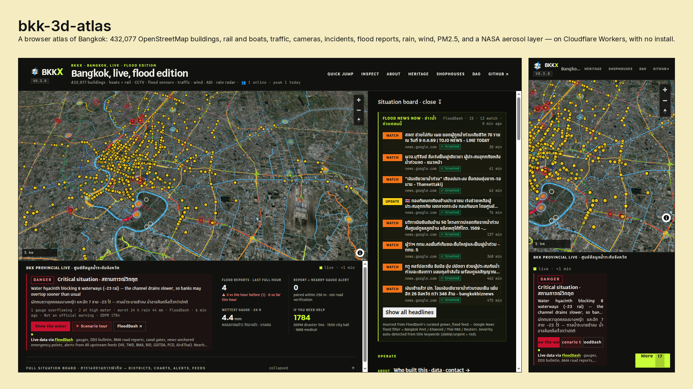
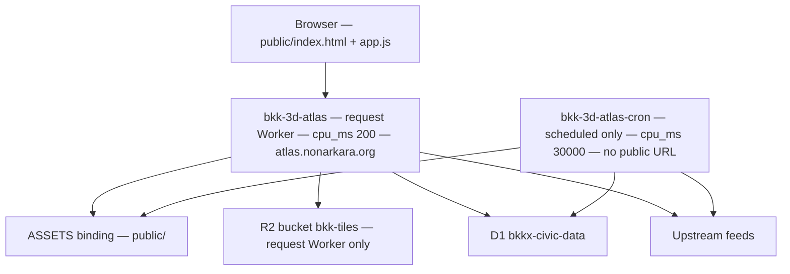
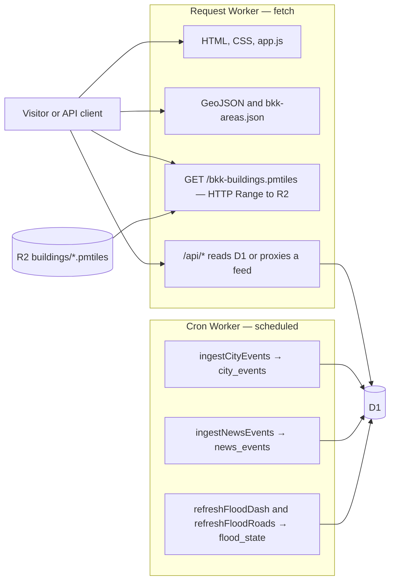

# bkk-3d-atlas



A browser atlas of Bangkok: 432,077 OpenStreetMap buildings, rail and boats, traffic, cameras, incidents, flood reports, rain, wind, PM2.5, and a NASA aerosol layer — on Cloudflare Workers, with no install.

[](https://atlas.nonarkara.org)
[](https://github.com/Nonarkara/bkk-3d-atlas/actions/workflows/verify.yml)

**Live:** <https://atlas.nonarkara.org> · API catalog: <https://atlas.nonarkara.org/api> · research note: <https://atlas.nonarkara.org/labs/paper>

## Screenshots

The picture above is `assets/hero.png`. It is the live site, captured 2026-10-10: a 1440×900 desktop viewport and a 390×844 phone viewport, both the default landing view at <https://atlas.nonarkara.org>. The mat is flat [Palette](https://github.com/Nonarkara/palette) plate 052, Sulpher Yellow `#f5ecc2`, with a 1px rule in the plate’s black `#111314`. The name and the pitch are set in Inter. The file is a raster capture, so it does not follow `prefers-color-scheme`. The atlas chrome inside it is the dark UI. Gauge readings in the picture are whatever the site was showing at capture time. Credits: [CREDITS.md](CREDITS.md).

Open the demo and use **Quick jump** (sixteen areas in `public/bkk-areas.json`) or the layer panel.

## What it does, and who it is for

The viewer is a static page in `public/`. MapLibre draws Esri imagery, OpenFreeMap roads, and building extrusions. A click reads height and building type, and can ask `/api/risk` for a civic score. Presets stack the city with rain, wind, heat, air quality, or flood without tearing the WebGL sources down. The Landmarks toggle stays off until it is asked, then lazy-loads ink drawings of the Chakri Maha Prasat, the Wat Phra Kaew terrace, Wat Arun, the Democracy Monument, the Giant Swing, and the Golden Mount.

It is for:

- Anyone who wants to look at Bangkok as stacked, sourced layers rather than a single basemap.
- Other dashboards (the package description names Chula and UNL) that can fetch `bkk-areas.json`, the GeoJSON under `public/`, or `/api/atlas/*`.
- A developer forking the Worker pattern for another city. There is no `CITY` variable. See [Fork it for your city](#fork-it-for-your-city).

It is not an official flood warning, a safe-route planner, or an insurance model. `/api/predict/timesfm` returns `status: "unavailable"` because no TimesFM service is connected. The limits are written up in [docs/shipability-2026-10-01.md](docs/shipability-2026-10-01.md).

The page header links a separate heritage register at `bkk.nonarkara.org`. That site is not this Worker.

## Architecture

One TypeScript entry, `src/index.ts`, is deployed as two Workers so a five-minute ingest cannot share a CPU cap with ordinary requests.



`wrangler.toml` is the request Worker: custom domain, R2, D1, static assets, `cpu_ms = 200`, no cron. `wrangler.cron.toml` is `bkk-3d-atlas-cron`: same script, same assets and D1, `crons = ["*/5 * * * *"]`, `cpu_ms = 30000`, `workers_dev = false`, no R2 binding and no hostname. Deploy cron first. Reversing the two uploads drops the schedule for the gap between them.

### Data flow



`/api/city-events` and `/api/news-events` also start a background ingest with `waitUntil` on the request Worker. The cron is the path that runs when nobody is looking. City-event background ingest is throttled to once per 120 seconds per isolate (`CITY_INGEST_EVERY_MS`).

## Tech stack

| Piece | What the repo uses |
| --- | --- |
| Viewer | Vanilla HTML, CSS, and ES modules in `public/`. No bundler. MapLibre GL 4.7.1 and `hls.js` 1.5.17 from CDNs. `pmtiles` 4.4.1 (`package.json` and the page). The Landmarks layer vendors a Three.js r186 subset at `public/vendor/three.module.js` and loads it only when toggled. |
| Map | OpenFreeMap dark style, Esri World Imagery, AWS Terrarium DEM (`elevation-tiles-prod`) for the terrain toggle. |
| Worker | TypeScript on Cloudflare Workers, `nodejs_compat`, compatibility date `2026-05-15`. Wrangler 4.92.0. |
| Store | R2 bucket `bkk-tiles` for PMTiles. D1 database `bkkx-civic-data` (`db/schema.sql`). |
| Checks | Node.js 22 in CI. `npm run verify`, `npm run typecheck`, `npm run test:flood`. |

`package.json` version is `0.1.0`. The badge in `public/index.html` reads `v0.3.0`.

## Quickstart

```sh
npm ci
npm run verify      # local checks, no network
npm run typecheck
npm run dev         # wrangler dev — http://localhost:8787
```

Python 3 is only needed for the extract and ingest scripts. `scripts/ingest-bma-open-data.py` asks for `pyproj` and `openpyxl`. `scripts/generate-3d-tiles.sh` shells out to `tippecanoe`. Those tools are not part of `npm ci`.

`npm run smoke` calls the live atlas unless you set `ATLAS_URL`.

## Configuration

Names only. Values stay in the Cloudflare dashboard, GitHub Actions secrets, or your shell. See [`.env.example`](.env.example).

**Worker secrets** (`npx wrangler secret put` — not in `wrangler.toml`):

- `LONGDO_KEY` — live `/api/traffic`. Unset is a normal 200 with `configured: false`.
- `GOOGLE_MAPS_API_KEY`
- `GOOGLE_WEATHER_API_KEY` — both are on the `Env` interface. `/api/weather/google` fetches Open-Meteo and does not call Google. The scoreboard reports the weather feed as configured when either name is set.

**`[vars]` in `wrangler.toml`:**

- `LONGDO_FEED`
- `LONGDO_DATA_ORIGIN`

**Bindings** (not environment variables): `ASSETS`, `BKK_TILES` (request Worker only), `CIVIC_DB`.

**Local / CI only:**

- `ATLAS_URL` — `scripts/smoke-atlas-api.mjs`
- `LIVE_URL`, `DEPLOY_CACHE_WAIT_SECS` — `scripts/deploy-live.sh`
- `CLOUDFLARE_API_TOKEN`, `CLOUDFLARE_ACCOUNT_ID` — `.github/workflows/deploy-cloudflare.yml`

## Data sources

Counts below are the feature counts and headers in `public/`, or constants in `src/index.ts`. A licence cell says “not recorded here” when this repository does not name one.

| Data | Where | Credit | Licence in this repo |
| --- | --- | --- | --- |
| 432,077 metro buildings, PMTiles, zoom 11–15 | R2 `buildings/bangkok.pmtiles`, route `/bkk-buildings.pmtiles`. Regenerated constant `2026-08-04`. | © OpenStreetMap contributors | ODbL 1.0 |
| 9,275 Rattanakosin footprints | `/bkk-buildings-rattanakosin.pmtiles` and `public/bkk-buildings-rattanakosin.geojson`, `public/bkk-heritage-detail.geojson` | OpenStreetMap. Height from `height`, else `building:levels * 3`, else 9 m. | ODbL 1.0 on the GeoJSON |
| 16 curated areas | `public/bkk-areas.json` | Derived from OpenStreetMap | ODbL 1.0 |
| 50 districts (khet) | `public/bkk-districts.geojson` — OSM relation 92277, `admin_level=6` | © OpenStreetMap contributors | ODbL 1.0 |
| 4,063 waterways (1,037 `river`, 3,026 `canal`) | `public/bkk-khlongs.geojson` | OpenStreetMap via Overpass | ODbL 1.0 |
| 126 rail segments, 9 line keys in `byLine` | `public/bkk-rail.geojson` | OpenStreetMap via Overpass | ODbL 1.0 |
| 20 boat features (4 corridors, 16 piers in the scoreboard) | `public/bkk-water-transit.geojson` | Chao Phraya Express Boat, Chao Phraya Tourist Boat, Government Contact Center note on Khlong Saen Saep | Not recorded as a licence id. Geometry is maintained orientation, not live positions. |
| 599 venues | `public/bkk-venues.geojson` | OpenStreetMap via Overpass, plus curated areas | ODbL 1.0 |
| 115 landmark extrusions; 43 held in quarantine | `public/bkk-landmarks.geojson` (`version` 2026-09-26), `public/bkk-landmarks-quarantine.geojson` | File text: OSM footprints, schematic heritage heights, curated skyline icons. The Fine Arts Department register (571 monuments) is the other site, not this file. | Not given a licence id on the landmark file. OSM footprints remain ODbL. |
| 8 wireframe landmarks | `public/wireframe-geometry.js`, drawn by `public/wireframe-landmarks.js` when the Landmarks toggle is on | Original line geometry. Coordinates from Wikipedia or the OSM footprints already in this repo. Reference photos are listed in [CREDITS.md](CREDITS.md) and are not shipped. | Code in this repo. Photos stay on Wikimedia Commons under the licences named in the credits. |
| 1,963 traffic sample segments, mock levels | `public/bkk-traffic-sample.geojson` | OpenStreetMap via Overpass. Live replacement is iTIC / Longdo. | ODbL 1.0 for the geometry. Levels are mock. |
| Live traffic | `/api/traffic` → `https://traffic.longdo.com/api/feed/itsth` | iTIC Foundation / Longdo. Historical archive linked from the previous README: <https://itic.longdo.com/opendata/>, described there as CC-BY 4.0 for the 2017–2023 dumps. | Live feed needs `LONGDO_KEY`. |
| 85 traffic cameras | `public/bkk-cctv.geojson`, `/api/cctv` | iTIC Foundation / Longdo, including Department of Highways cameras carried on that platform | Not recorded here |
| 4 hand-placed YouTube streams | `public/bkk-live-cams.geojson` | Public YouTube livestreams via YouTube’s player. Not cameras this project operates. | YouTube’s own terms. Coordinates are exact only where the file says so. |
| Maholan cameras | `/api/water/bkk/maholan-cctv`, snapshots `/api/snap/<id>` | `cctv.maholan.net`. Filtered to Bangkok plus a 30 km halo. | Not recorded here |
| 5 schematic flood envelopes | `public/bkk-flood-envelope.geojson` | Drawn for this project from the 2011 floods and monsoon drainage, as a sandbox | CC0-1.0 in the file. Not an official flood map. |
| FloodDash relay | `/api/flood/bkk`, `/api/flood-sensors`, `/api/water/bkk/*` | `flood.nonarkara.org`, which aggregates HII / ThaiWater, BMA DDS, and others. Scoreboard text names about 40 upstream feeds. | Not recorded here |
| Road reports snapped to streets | `public/flood-roads/` — manifest: 267,856 ways, built 2026-09-27 | OpenStreetMap via Overpass for the roads. Reports from Traffy Fondue (`publicapi.traffy.in.th`), iTIC / Longdo via FloodDash, and BMA DDS via FloodDash. | ODbL 1.0 on the road geometry |
| 133 rain gauges | `public/bkk-rain-stations.geojson` | Hydro-Informatics Institute / ThaiWater v3, `province_code=10`. Also RID and BMA drainage in the file attribution. | Not recorded here |
| Land price, 50 district polygons | `public/bkk-land-price-districts.geojson` | Home Buyers Team summary of Treasury Department draft appraisal data. Scoreboard constant: 2,281,482 parcels, source string `Treasury 2024-2028`. The fill is the highest road in that district group, not “the district’s price”. | The file says it is not the official gazette. |
| 1,725 civic POIs | `public/bkk-civic-pois.geojson`, table `civic_pois` | `data.go.th` / `data.bangkok.go.th`. Ingest script: schools, sports grounds, car parks, museums, waterway landmarks. | “CC-licensed” / “Creative Commons” in the file and script. A specific CC version is not named. |
| City incidents | D1 `city_events`, `/api/city-events` | Longdo / iTIC `https://event.longdo.com/feed/json` | Not recorded here. Pins keep reporter coordinates. Icons kept: accident, flood, fire, trafficjam, roadclosed, rain, earthquake, protest, warning. Events longer than 24 h are dropped. TTL 60 minutes. |
| News pins | D1 `news_events`, `/api/news-events` | Bangkok Post RSS, Khaosod English RSS, optional GDELT DOC API | Not recorded here. 14-day window. No pin without a gazetteer match. |
| Rain radar | Browser → RainViewer manifest | RainViewer | Not recorded here |
| PM2.5, heat, wind, `/api/weather/google` | Open-Meteo, including the air-quality API for PM2.5 | Open-Meteo. Attribution URL in `src/weather-support.ts`. | Not recorded here. Model grids, not street sensors. |
| Satellite aerosol | NASA GIBS WMTS, MODIS MAIAC AOD | © NASA EOSDIS GIBS | Not recorded here. The layer status says regional AOD, not PM2.5. |
| Imagery | Esri World Imagery | © Esri, Maxar, Earthstar Geographics | Scoreboard string: non-commercial use |
| Terrain | AWS Open Data Terrarium tiles | Terrain © Mapzen / Tilezen · AWS Open Data · SRTM, ASTER, GMTED2010 | Not recorded here |

## Deploy

Account id pinned in both Wrangler configs: `74ad6bf8dfaaccf82de6f0847f7d2d54`. Hostname: `atlas.nonarkara.org`.

```sh
npm run deploy
```

That runs `wrangler deploy --config wrangler.cron.toml` and then `wrangler deploy`.

`npm run deploy:live` (`scripts/deploy-live.sh`) fetches `main`, checks out `main`, checks that the About markup and landmark wiring are present, checks `wrangler whoami`, deploys cron then the request Worker, waits (default 12 seconds, `DEPLOY_CACHE_WAIT_SECS`), and curls the live HTML. The wait is there because a fresh asset upload can still return `cf-cache-status: HIT` for a few seconds.

GitHub Actions (`.github/workflows/deploy-cloudflare.yml`) deploys both Workers on push to `main` after the same verify steps, once `CLOUDFLARE_API_TOKEN` and `CLOUDFLARE_ACCOUNT_ID` exist as repository secrets. Until they do, deploy from a machine that is logged in to that Cloudflare account.

Regenerate the building archive when OSM changes:

```sh
python3 scripts/osm-buildings-to-geojson.py \
  --bbox 100.30,13.45,100.95,14.10 \
  --output /tmp/bkk-buildings/bangkok-buildings.geojson
# then scripts/preprocess-buildings.py, tippecanoe, and:
# npx wrangler r2 object put bkk-tiles/buildings/bangkok.pmtiles --file=... --remote
```

`scripts/generate-3d-tiles.sh` wraps those stages. Do not put the PMTiles file in `public/`. The assets binding does not honour HTTP Range, and the `pmtiles` client needs Range.

## Cost guards

Measured cold pass recorded in `wrangler.cron.toml` (2026-10-09, network wait excluded):

| Step | CPU |
| --- | --- |
| News venue match, 155 articles × 599 venues | ~657 ms |
| Parse `bkk-khlongs.geojson` | ~57 ms |
| Snap 40 flood reports on 4 dense road cells | ~56 ms |
| City-event district point-in-polygon × 20 | ~15 ms |
| Decode 4 flood-road cells | ~13 ms |
| One cron-shaped pass | ~823 ms |

A flood day touches more road cells, so the cron cap is the platform maximum, 30,000 ms, not a tight estimate. The request Worker stays at 200 ms. Putting the cron on `wrangler.toml` would either kill ingest or drop the request cap.

Other bounds in `src/index.ts`:

- `/api/traffic` with a key: 30 requests per minute per IP per isolate, then HTTP 429. The counter resets on a cold isolate.
- Upstream `fetch` times out at 20 seconds.
- D1 `flood_state` caches water proxies. TTLs in code include 90 s (traffic), 300 s (CCTV, risk, ThaiWater provincial routes, news), 60 s (flood sensors, FloodDash verdict, TimesFM unavailable body), 180 s (weather model).
- Presence (`/api/presence`) is in-memory per isolate. It does not log IPs. It is not a durable visitor counter.

## How it works

A short reading path if you want to learn the system rather than only run it.

1. **The page.** `public/index.html` is one screen: map, panel, About drawer. `public/app.js` declares layers in a `LAYERS` array. Each entry has an id, a default visibility, the MapLibre layer ids it toggles, and `install` / `uninstall`. Adding a layer is one object plus its source. Toggles hide layers; they do not destroy the WebGL sources, so rain and air quality can come back without a full reload.
2. **Buildings.** The browser loads `pmtiles` and requests byte ranges at `/bkk-buildings.pmtiles`. `servePmtilesFromR2` turns `Range` into `BKK_TILES.get(key, { range })` and returns 206. A single GeoJSON of the same 432,077 footprints is too large for the browser; the tile archive is not. If that PMTiles is unreachable, the client falls back to OpenFreeMap buildings. From zoom 14 the Rattanakosin archive takes over through zoom 18.
3. **A click.** Inspect reads the feature under the cursor. `/api/risk?lng=&lat=` combines the schematic flood polygon, a live PM2.5 reading, and land-price context. The response is a demo score from 0 to 100. The flood polygon is not an official extent.
4. **The mirror API.** `/api/atlas/areas`, `districts`, `at-this-point`, `transit`, `buildings`, and `scoreboard` are thin GETs for a script or an agent. `buildings` returns pointers to the PMTiles. It does not run a server-side bounding-box query over 432,077 features. `at-this-point` rejects coordinates outside the Bangkok bbox.
5. **The clock.** Every five minutes `scheduled` on the cron Worker ingests Longdo events, matches news against the venue gazetteer, refreshes FloodDash into `flood_state`, and snaps flood reports onto `public/flood-roads/` cells. A visitor hitting `/api/city-events` reads D1 immediately and may refresh in the background.
6. **What a pin is allowed to mean.** Read the comments on `city_events` and `news_events` in `db/schema.sql`. Those comments are the contract: reporter coordinates, or a quoted place name, or no pin.

House colours for the UI are separate from the Sulpher Yellow frame on the README screenshot: signal yellow `#c9ff38`, paper `#f1efe8`, ink `#11120f` (`public/style.css`). The typeface is Sao Chingcha, self-hosted.

## Fork it for your city

There is no city switch. Bangkok is baked into the data files, the bounding boxes, and the Cloudflare names. A fork that only renames the title would still be Bangkok.

1. Fork, keep the two-config Worker split, and keep `cpu_ms` 200 on the request Worker.
2. Replace `public/bkk-areas.json` and the GeoJSON you still want. Delete layers you will not feed. Do not relabel Bangkok extracts as another city.
3. Search `src/index.ts` for the boxes you must change: `CCTV_BBOX`, `BKK_INCIDENT_BBOX`, `BKK_INCIDENT_HALO_BBOX`, `DAM_BBOX`, `ALERT_HALO_BBOX`, `MAHOLAN_BBOX`, and the hard-coded Bangkok window `13.4–14.2` / `100.2–101.1` on `/api/risk`’s neighbours and `/api/weather/google`. ThaiWater URLs use `province_code=10`.
4. Point `wrangler.toml` and `wrangler.cron.toml` at your account, script names, D1 database, and — on the request Worker only — your R2 bucket and hostname. `npm run deploy:live` checks out `main` and expects this account id and `atlas.nonarkara.org`. Write your own deploy script or edit those checks.
5. Build a PMTiles for your buildings (`scripts/osm-buildings-to-geojson.py` takes `--bbox`) and upload it under the key `servePmtilesFromR2` reads: `buildings/bangkok.pmtiles` and `buildings/bangkok-rattanakosin.pmtiles`, unless you change those constants.
6. Apply `db/schema.sql` to your D1 database before expecting civic rows, events, or flood cache.
7. Keep upstream licences. OSM stays ODbL. Attribute Esri, NASA, and any feed you still call.
8. Run `npm run verify`, `npm run typecheck`, and `npm run test:flood`. The flood tests assume this project’s report rules; update them if you remove flood layers rather than letting them fail silently.

Feeds that are Bangkok-specific and will not transfer: Longdo / iTIC traffic and events, BMA open data, ThaiWater province 10, Traffy Fondue, the Chao Phraya boat file, and FloodDash. Open-Meteo, RainViewer, NASA GIBS, Esri imagery, and OpenFreeMap are the pieces that are not tied to one municipality.

## Roadmap

This is the list published in the About drawer (`public/index.html`, `#about-roadmap`), not a dated commitment.

1. Official flood extents — replace the schematic envelope when DDPM or BMA GeoJSON is open.
2. Property-tax verifier — deed or parcel lookup against Treasury zones and a typed bill.
3. BTS / MRT isochrones — 5, 10, and 15 minute walksheds.
4. Risk API v3 — rain intensity and building height in the score.
5. Offline atlas pack — MapLibre, pmtiles, and samples on a USB stick.

Further out, the same drawer names a handover of the twin, cadastral polygons (it says the blocker is institutional, not code), and denser tourist / planning / command-center chrome after the civic layers are reliable.

`/api/atlas/buildings` still documents that there is no server-side bbox query. `/api/predict/timesfm` is an explicit empty. Both are current behaviour, not hidden roadmap items.

## FAQ

**Why are there two Workers?**  
A cold ingest measured about 823 ms of CPU. The request Worker is capped at 200 ms. The schedule lives in `wrangler.cron.toml` on `bkk-3d-atlas-cron`.

**Why is the PMTiles in R2?**  
The static assets binding returns the whole object and ignores `Range`. The `pmtiles` client needs ranges. The Worker proxies R2.

**Does traffic work without a Longdo key?**  
Yes. `/api/traffic` returns HTTP 200, `configured: false`, and no `features`. The map uses `public/bkk-traffic-sample.geojson` and labels the levels as mock.

**Are the flood polygons official?**  
No. Five schematic envelopes, CC0 in the file, not for evacuation, insurance, or planning. Lit streets mean a report was snapped nearby, not that the road was surveyed.

**Are the boats live?**  
No. Four corridors and sixteen piers are scheduled orientation.

**Can I underwrite a property from `/api/risk`?**  
No. It is a civic demo score. Land-price numbers are a media summary of Treasury draft data, not the gazette.

**Is TimesFM running?**  
No. The route says no inference service is connected and that arrival times and depths were not calculated.

**What is the UI version versus `package.json`?**  
`package.json` says `0.1.0`. The header badge in `public/index.html` says `v0.3.0`.

**Where is the licence?**  
There is no `LICENSE` file. OSM-derived data is ODbL regardless. See [CREDITS.md](CREDITS.md) and the data table above.


*Look closer. The rain is hiding a cat with a red umbrella, 1784, a rubber duck, and a drone.*

## Community

- [CONTRIBUTING.md](CONTRIBUTING.md)
- [CODE_OF_CONDUCT.md](CODE_OF_CONDUCT.md) — Contributor Covenant 2.1
- [SECURITY.md](SECURITY.md)
- [CREDITS.md](CREDITS.md)

Contact published on the atlas: nonsmartcity@gmail.com · <https://nonarkara.org> · <https://github.com/Nonarkara/bkk-3d-atlas>
